# Accomplishments Digest — Multi-Source Performance-Review Prep

This flowspace turns a review period's worth of work evidence into a single,
readable accomplishments document an engineer can hand to their manager. The
evidence comes from Jira, Confluence, Microsoft 365 (recognition, resolution
threads, meeting recaps), and ServiceNow (operational volume). It exists
because the raw material is scattered, ticket-shaped, and easy to undersell.
The flow's job is to gather it faithfully, merge evidence about the same work
into one accomplishment, reframe it in outcome terms grouped by theme, and
carry the engineer's own read on impact rather than substitute an agent's
guess for it. One run = one finished document for one review cycle.

## Stage Flow Diagram

```mermaid
flowchart LR
    S1["1. Frame<br/>review: heavy"]:::heavy --> S2["2. Gather — Jira<br/>review: light"]:::light
    S2 --> S3["3. Gather — Confluence &amp; Collaboration<br/>review: light"]:::light
    S3 --> S4["4. Gather — Microsoft 365<br/>review: light"]:::gap
    S4 --> S5["5. Gather — ServiceNow<br/>review: light"]:::gap
    S5 --> S6["6. Correlate<br/>review: heavy"]:::gap
    S6 --> S7["7. Draft<br/>review: light"]:::light
    S7 --> S8["8. Align &amp; Publish<br/>review: heavy"]:::heavy
    S8 --> S9["9. Word Output<br/>review: light"]:::light

    classDef heavy fill:#78350f,stroke:#fbbf24,color:#fef3c7
    classDef light fill:#1e3a8a,stroke:#60a5fa,color:#dbeafe
    classDef gap fill:#7f1d1d,stroke:#f87171,color:#fee2e2
```

> Stages 4, 5, and 6 still carry the `gap` color from when their skills
> existed only as filed briefs. All three skills are now built and staged for
> review (see Known gaps); the diagram refresh is deferred to a later update
> pass. Their intended review intensity is in the
> node label and the Stage table. The diagram keeps the flat-chain convention
> (`references/flow-diagram-guide.md`). In practice, Stages 2–5 have no
> dependency on each other and can run in any order or in parallel. Each one
> runs only if Stage 1's capability probe found its source reachable and in
> scope; otherwise it records a declared skip. Stage 9 is optional, because
> Stage 8's publish is already the flow's complete, terminal artifact.
> Stage 6 is a deliberate mid-flow heavy gate (operator decision,
> 2026-10-27). See its `CONTEXT.md` and the decision log.

## Stage table

| # | Stage | Review intensity | Max data-class | Sanctioned engines | Layer-3 |
|---|---|---|---|---|---|
| 1 | Frame | heavy | internal | Rovo, Copilot | inline — human judgment + capability probe, no skill |
| 2 | Gather — Jira | light | internal | Rovo (Copilot if sanctioned) | `jira-accomplishments-gatherer` (verified, `produced-skills/`) |
| 3 | Gather — Confluence & Collaboration | light | internal | Rovo (Copilot if sanctioned) | `confluence-contribution-gatherer` (verified, `produced-skills/`) |
| 4 | Gather — Microsoft 365 | light | internal (after screen) | runtime — any engine sanctioned for Graph | `m365-accomplishments-gatherer` (1.0, to-review, `skill-foundry/review-skills/`) |
| 5 | Gather — ServiceNow | light | internal | runtime — any engine sanctioned for ServiceNow; export mode on any | `servicenow-accomplishments-gatherer` (1.0, to-review, `skill-foundry/review-skills/`) |
| 6 | Correlate | heavy | internal | any sanctioned for internal | `accomplishments-correlator` (1.0, to-review, `skill-foundry/review-skills/`) |
| 7 | Draft | light | internal | any sanctioned for internal | `accomplishments-drafter` (verified 1.0 in `produced-skills/`; 2.0 revision to-review in `skill-foundry/review-skills/`) |
| 8 | Align & Publish | heavy | internal | Rovo, Copilot | inline — human judgment, no skill |
| 9 | Word Output (optional) | light | internal | runtime — any that can produce `.docx` | `accomplishments-docx-stylizer` (verified 1.0 in `produced-skills/`; 2.0 revision to-review in `skill-foundry/review-skills/`) |

**Engine selection is at runtime (2.0).** No single engine carries the whole
run. Stage 1 probes what the running engine can reach, and each gather stage
runs or declares a skip on that basis. Stage 9 checks for `.docx` output
capability and then asks the engineer: build from the default style, or use
their own template.

## Source-repo

- **Source-repo:** `<internal repo>` → `flows/accomplishments-digest/` — the
  sole source of truth (`methodology/source-repo-protocol.md` §1).
- **External systems read (read-only):** Jira, Confluence, Microsoft 365 via
  Microsoft Graph (Outlook, Teams chat and meeting recaps,
  SharePoint/OneDrive), and ServiceNow (incident, change task, catalog task,
  and problem task tables).
- **External systems written:** Confluence only, at Stage 8. The
  deliverable destination is `<Confluence space set at instantiation>`: an
  `Accomplishments` page tree, one page per review cycle per engineer.
- **Published copy (interim):** where an engine must read the flow, a
  read-only, version-stamped Confluence copy (§6). Confirm the Mermaid macro
  is installed in the target space before this diagram ships there. Without it,
  the page notes "diagram: see source-repo."

This public copy is the sanitized *design*. Instantiation happens in employer
tenancy per `methodology/source-repo-protocol.md`. At instantiation, add the
per-stage `work/` folders (Layer-4, transient, one set per review cycle).
They are deliberately absent here, since they only ever hold per-run content.

## Run procedure

The engineer starts a run ahead of a scheduled review. Stage 1 sets the
period, the audience, and the engineer's own framing of what mattered. It also
probes which sources the engine can reach, confirms which are in scope, and
turns the exclusion list into search filters. This is the
heaviest-judgment stage, and the one place where the agent should ask more
than it tells. Stages 2–5 each gather from one source against the period
Stage 1 set, and land a theme-grouped digest or a declared skip. Stage 6 loads
all of that evidence together and merges evidence about the same work
across sources into accomplishment groups. The engineer confirms those groups before any prose is written,
because a wrong merge here carries into everything after it. Stage 7 drafts
from the confirmed groups into the house document shape, including an
Operational load section when ServiceNow ran. Stage 8 is the engineer's own
edit pass against their Stage 1 framing before anything is shared. It's the
boundary that keeps the document reading as the engineer's own account
instead of an AI-generated ticket list. Stage 8's published document is the
flow's terminal artifact. If the engineer also wants a styled Word version,
Stage 9 styles that same approved document, never the pre-review draft,
using the default style or the engineer's template.

## Known gaps

> Per `methodology/governance-and-audit.md` §5a: each entry below is a
> pointer, not an archive — 1–3 sentences plus the decision-log citation
> that carries the full rationale.

**2.0 revision (2026-10-27).** This version adds Microsoft 365 and ServiceNow gathering, a
Correlate stage, runtime engine selection, and Word styling as a stage
skill. It also retires the companion `accomplishments-docx-finisher` flow.
Rationale: `decision-log/2026-10-27-m365-servicenow-revision.md`.

| Skill | Brief | Target stage | Status |
|---|---|---|---|
| `jira-accomplishments-gatherer` | `sp-jira-accomplishments-gatherer` | 2 | verified — deployment pending |
| `confluence-contribution-gatherer` | `sp-confluence-contribution-gatherer` | 3 | verified — deployment pending |
| `m365-accomplishments-gatherer` | `sp-m365-accomplishments-gatherer` | 4 | built 1.0 — staged to-review, awaiting gate |
| `servicenow-accomplishments-gatherer` | `sp-servicenow-accomplishments-gatherer` | 5 | built 1.0 — staged to-review, awaiting gate |
| `accomplishments-correlator` | `sp-accomplishments-correlator` | 6 | built 1.0 — staged to-review, awaiting gate |
| `accomplishments-drafter` | `sp-accomplishments-drafter-revision` | 7 | verified 1.0; 2.0 revision staged to-review, awaiting gate (correlation-map input, Operational load) |
| `accomplishments-docx-stylizer` | `sp-accomplishments-docx-stylizer-revision` | 9 | verified 1.0; 2.0 revision staged to-review, awaiting gate (direct input, build-or-template ask, engine-agnostic) |

All five skills were built on 2026-10-27 and staged in
`skill-foundry/review-skills/` at `to-review`; build rationale is in
`skill-foundry/decision-log/2026-10-27-*`. Until each new skill passes the
gate, its stage runs inline from its `CONTEXT.md` Process field. Until the
two 2.0 revisions pass, the verified 1.0 skills run with the new behavior
inline, as each stage's Layer-3 line describes.

Per-tenant probes: the Confluence activity-history depth check
(`reference/confluence-activity-history-capability-check.md`, Stage 3) and,
new in 2.0, the ServiceNow attribution field check
(`reference/servicenow-attribution-capability-check.md`, Stage 5).

## Reference material (Layer-3)

| Artifact | Location | Covers |
|---|---|---|
| Revision primer brief | `flow-foundry/backlog-flow-starters/fp-accomplishments-digest-m365-servicenow.md` | The intake record and operator decisions behind 2.0 |
| Document shape | `reference/accomplishments-document-shape.md` | The house template Stages 7–8 write and edit against (2.0 adds Operational load) |
| Default Word style | `reference/docx-minimal-default-style.md` | The "build from default" option at Stage 9 (moved from the retired finisher) |
| Confluence Activity-History Capability Check | `reference/confluence-activity-history-capability-check.md` | One-time-per-tenant probe for Stage 3's collaboration-signal depth |
| ServiceNow Attribution Capability Check | `reference/servicenow-attribution-capability-check.md` | One-time-per-tenant probe for Stage 5's "whose work is this" field |
| Provenance spec | `methodology/provenance-spec.md` | Frontmatter rules for all artifacts |
| Governance & Audit | `methodology/governance-and-audit.md` | Gate requirements |
| Source-Repo Protocol | `methodology/source-repo-protocol.md` | Source-repo, external systems, and published copies |
