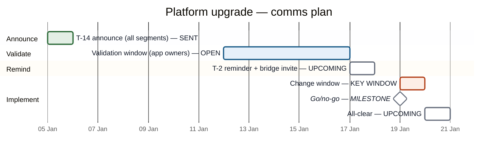

# Timeline and Validation Tracker

Stage 4 builds the campaign timeline as a Mermaid `gantt`, delivered as a
**rendered image plus the raw Mermaid**, with colors that carry meaning and
a legend. Colors come from the instance's design-system binding
(`design-system-binding.md`); the values below are the brand-neutral
default.

## Color roles

Mermaid gantt colors tasks by state, so each role maps to a state tag.
Color never stands alone: each label also carries the word.

| Role | Gantt tag | Meaning | Neutral default (fill / border) |
|---|---|---|---|
| Upcoming | *(none)* | Touchpoint not yet sent | `#ffffff` / `#6b7280` |
| Sent | `done` | Touchpoint sent | `#e3efe5` / `#2e6b3a` |
| Awaiting validation | `active` | A validation window is open | `#e6f0fa` / `#1f5f8b` |
| Key window | `crit` | The change window or response period itself | `#fdeee6` / `#b4441e` |
| Milestone | `milestone` | Go/no-go, all-clear, deadline | drawn as a diamond in the task colors |

Text is `#111827` on every fill (all pairs above 4.5:1).

## Example (neutral default)

Legend line to print under every rendered image:
`Upcoming · Sent · Awaiting validation · Key window · Milestone` — each in
its color.

## Rendering

- **Image:** render with the engine's own capability where it has one.
  Never paste plan content into an unsanctioned external renderer.
- **Raw Mermaid:** always delivered in a fenced block, so it can be pasted
  into a Confluence Mermaid macro or edited later.
- **Table fallback:** used for Jira comments (no Mermaid rendering), and
  anywhere the image cannot be produced:

| Date | Touchpoint | Segments | Channel | Status |
|---|---|---|---|---|

## Validation tracker

One row per validation ask from Stage 3. Status values: not started · in
progress · confirmed · issue raised.

| Validates | Team (group) | What is confirmed | Due | Status | Evidence link |
|---|---|---|---|---|---|
