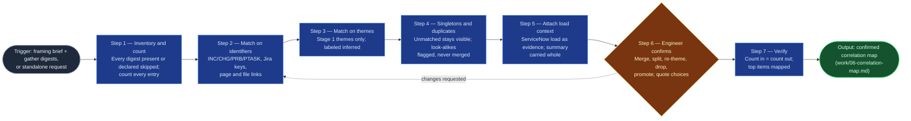

# Accomplishments Correlator

The Stage 6 skill of `accomplishments-digest`. The gather stages each report
one source, so a single fix can appear as a ticket, an incident, a Teams recap
decision, and a thank-you email: four bullets for one accomplishment, or worse,
a thank-you with no link to the work it praised. This skill joins that evidence
into accomplishment groups and puts the groups in front of the engineer to
confirm before any prose is written. It correlates and presents only; it never
drafts, and it never decides what counts as one accomplishment without the
engineer.

## Flow Diagram

## Triggering intent

- **Fires on:** Stage 6 of `accomplishments-digest`, with Stage 1's framing
  brief and the gather digests in hand; also standalone on "tie my tickets,
  emails, and incidents together into accomplishments," "which of these
  records are the same piece of work," or "group my evidence by accomplishment."
- **Does not fire on (near-misses):** drafting accomplishment prose
  (`accomplishments-drafter`); deduplicating or rationalizing a Jira backlog
  (`portfolio-rationalization`); gathering from any source (the four gatherer
  skills); correlating anyone's evidence but the engineer's own, including a
  manager assembling material about a report.

## Method

1. **Inventory and count.** Confirm each of the four digests (Jira,
   Confluence, Microsoft 365, ServiceNow) is either present or explicitly
   declared skipped or unreachable by its stage. A skipped digest counts as
   present and its gap is carried forward. A digest that is simply missing is
   not acceptable: stop and ask the engineer to run or explicitly skip that
   stage. Give every entry in every present digest a stable working ref
   (`J-1`, `C-1`, `M-1`, `S-1`, in digest order) and record the per-digest
   entry counts. These counts are the baseline for step 7. The ServiceNow
   digest's assigned-but-not-resolved list is carried separately as context
   (see step 5), not counted as evidence entries.
2. **Match on hard identifiers.** Pull every identifier from every entry:
   INC/CHG/PRB/PTASK/CTASK/SCTASK numbers, Jira keys, Confluence page links
   or IDs, SharePoint/OneDrive file references. Entries sharing an identifier
   join one group, including transitively (A shares a key with B, B shares an
   incident number with C: one group, with the chain shown). Match basis:
   `identifier`, naming the identifier. Match on the exact identifier string
   only; "similar number" or "same prefix" is not a match.
3. **Match on themes.** For groups and entries still unattached, place them
   under a Stage 1 theme or top item only when the link is clear in the
   entries' own content. Match basis: `inferred`, with a one-line reason.
   An `inferred` link must read as visibly weaker than an `identifier`
   link everywhere it is shown (label, ordering, and a "confirm this link"
   prompt in step 6). An inferred match never overrides or splits an
   identifier match.
4. **Keep singletons; flag look-alikes.** Anything unmatched stays as its own
   group, match basis `singleton`. Never merge on similarity alone: two
   entries with similar descriptions but no shared identifier and no clear
   theme link stay separate and carry "possible duplicate: engineer to
   decide" pointing at each other. Nothing is dropped here; only the engineer
   drops.
5. **Attach load context.** ServiceNow records attach to the groups they
   support as evidence entries, and counts may appear against a theme as
   supporting detail. The ServiceNow load summary (counts by type, priority
   mix, median time to resolve, problem-led fixes, reopens) is carried whole
   and unaltered into the output for the Operational load section. The
   assigned-but-not-resolved list is carried whole as its own section. Load
   figures are evidence, never a headline, and are never compared with peers
   or a team average.
6. **Present for confirmation (heavy gate).** Show the groups ordered with
   Stage 1 top items first, then other themes, then singletons. For each group:
   working title, theme, match basis, every evidence entry with source and
   citation, and any flags. Ask the engineer to: confirm, merge, split,
   re-theme, drop, or promote each group; resolve each "possible duplicate"
   flag; confirm each `inferred` link; choose any verbatim recognition quote
   they want used (default is paraphrase, no named quote unless picked); and
   confirm that each top item has a group or accept a "narrative only" flag.
   Apply the changes and re-present the changed groups until the engineer says
   plainly that the map is right. Do not treat silence, a skim, or "looks
   fine" on a partial view as confirmation, and do not proceed to output
   without an explicit confirmation of the full map.
7. **Verify and write the map.** Run two checks and show the results.
   *Coverage:* every entry counted in step 1 appears in exactly one group or
   is listed as dropped by the engineer; count in equals count out, per
   digest and in total. *Top items:* every Stage 1 top item maps to at least
   one confirmed group or carries a "narrative only" flag the engineer
   accepted. A failed check goes back to step 6, never forward. Then write
   `work/06-correlation-map.md` and a one-line decision-log entry naming the
   result and the engineer's merges, splits, and drops.

**Worked example A: one incident, three sources.** `INC0012345` appears in
the ServiceNow digest (resolved, P2), in a Teams recap entry ("agreed the
root-cause fix for INC0012345 ships Thursday"), and in a thank-you email
entry that names the same incident. Step 2 produces one group, basis
`identifier: INC0012345`, three entries. The engineer is asked only to
confirm it and, if they want, pick a quote from the email.

**Worked example B: two look-alikes.** Two ServiceNow entries read "Core
switch port flapping, site A" and "Core switch port flapping, site B" with
different INC numbers, and neither is linked to anything else. Step 4 keeps
two singleton groups, each flagged "possible duplicate: engineer to decide."
The skill does not merge them, and does not pick which is real.

**Worked example C: weak versus strong.** A Confluence page on "firewall
rule cleanup" and a Jira epic on the same theme share no key or link. Step 3
may place both under the Stage 1 theme "network hygiene," labeled `inferred`
with its reason, as two entries in one theme group. It is never presented
as the same strength as an incident-number match.

## Inputs and grounding

Reads: `work/01-framing-brief.md` (period, themes and top items, exclusion
list, sources in scope), and `work/02-jira-digest.md`,
`work/03-confluence-digest.md`, `work/04-m365-digest.md`,
`work/05-servicenow-digest.md`, each present or declared skipped. Where an
engine has no file access (chat session), ask the engineer to paste the
digests; that is a valid reduced-input path. If only some digests are pasted,
ask whether the others were skipped or simply not supplied, per step 1.

Grounding rules: every group, link, and flag traces to entries actually in the
digests. Never invent an identifier, a source, or an outcome. Never infer a
person's involvement or a link from similarity of wording alone. Group titles
are working labels built from the entries' own content, not new claims. State
"no match found" rather than manufacturing a connection. No external queries:
this skill works only on material already gathered.

## Data boundary

- Max data-class: `internal`, carried from the digests. No external queries.
- Digests may contain work-fact paraphrases of mail, chat, and ServiceNow
  records. The skill adds no new content beyond working titles. It does not
  expand a paraphrase into a direct quote, and it names colleagues only as
  they appear in the digests (as thankers, collaborators, or requesters).
  If an entry looks like `confidential` or `restricted` content, or matches
  the Stage 1 exclusion list, stop, flag it, and ask the engineer before
  grouping it.
- Sanctioned engines: any engine sanctioned for `internal` content, per the
  employer matrix. This is pure synthesis; no source connector is needed.

## What this skill is not

- **Not a drafter.** It produces a map of evidence groups, not prose.
  `accomplishments-drafter` writes from the confirmed map.
- **Not a backlog deduplicator.** It correlates one engineer's evidence
  across sources; `portfolio-rationalization` owns backlog hygiene.
- **Not a gatherer.** It does not query Jira, Confluence, Microsoft 365, or
  ServiceNow; the gatherer skills do.
- **Not an evaluator of anyone.** It correlates the requesting engineer's own
  record only, declines to correlate another person's evidence, and never
  compares volume with peers or averages.
- **Not an auto-merger.** It never merges on similarity alone, never lets an
  inferred match look as strong as an identifier match, and never drops an
  entry. Only the engineer drops.
- **Not self-confirming.** The confirmation in step 6 is the engineer's;
  the skill cannot supply, assume, or imply it.

## Review criteria

A single output of this skill is acceptable when:

1. Count in equals count out: each entry in each digest appears in exactly
   one group or in the engineer's dropped list, with per-digest counts shown.
2. Every group carries a match basis (`identifier` naming the identifier,
   `inferred` with its reason, or `singleton`), and `inferred` is visibly
   distinguishable from `identifier` wherever shown.
3. No merge exists on similarity alone; look-alike entries without a shared
   identifier or clear theme link are separate and flagged "possible
   duplicate."
4. Every Stage 1 top item maps to a confirmed group or an accepted
   "narrative only" flag.
5. The ServiceNow load summary and assigned-but-not-resolved list are carried
   whole and unaltered, with no peer comparison and no volume as headline.
6. Digest gaps (skipped or unreachable stages) are carried forward by name,
   not silently omitted.
7. Every disposition (keep, merged, split, dropped), every approved quote, and
   the engineer's explicit confirmation of the full map are recorded; no
   recognition quote is named that the engineer did not pick.
8. Simulated run 1: one incident present in three sources yields exactly one
   group. Simulated run 2: two look-alike incidents with different numbers
   yield two groups plus a duplicate flag.

## Changelog

- **1.0** (2026-10-27) — Initial build from `sp-accomplishments-correlator`.
