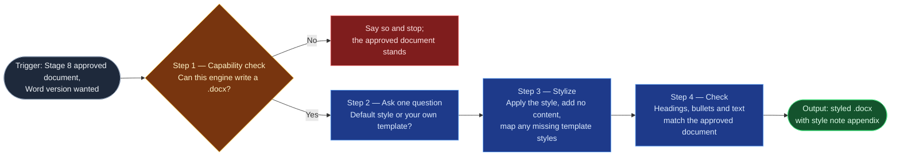

# Accomplishments Docx Stylizer

Stage 9 of `accomplishments-digest`. The engineer has already approved the
content at Stage 8; this skill only changes its format. It takes the
published document, asks which style to use, produces a `.docx`, and checks
that the result matches the approved document. It replaces 1.0, which sat
inside the retired `accomplishments-docx-finisher` flow, took an enriched
content set with flagged additions, and ran on Copilot only. None of those
three things apply any more: there is no enrichment step, the input is the
approved document, and any sanctioned engine that can write a `.docx` can run it.

## Flow Diagram

## Triggering intent

- **Fires on:** Stage 9 of `accomplishments-digest`, given Stage 8's published
  document. Also direct requests such as "make a Word version of my
  accomplishments" or "put the approved accomplishments doc into our template",
  provided the document follows the accomplishments document shape and has
  already been approved by the engineer.
- **Does not fire on (near-misses):**
  - Drafting, editing, or rewording accomplishments content (Stages 7 and 8).
  - Adding evidence, citations, or repo and file context to the content. The
    retired finisher flow did this; evidence now enters at Stages 2-6, before
    the human gates.
  - A Stage 7 pre-review draft. Only content the engineer has approved gets styled.
  - Styling documents of any other shape (SOPs, status reports, slide content),
    or generating Word documents from scratch.

## Method

1. **Capability check.** Confirm the running engine can write a `.docx` file
   (for example through a code or document tool, or a native Word export). If
   it cannot, say so plainly and stop. Do not produce a degraded substitute
   such as rich text pasted into chat and called a Word file. Tell the engineer
   the approved Stage 8 document stands as the deliverable, and that this step
   can be re-run on an engine that can write `.docx`.
2. **Ask one question, and wait for the answer.** Offer exactly two choices:
   **(a) build from the default style**
   (`flow-foundry/review-flowspaces/accomplishments-digest/reference/docx-minimal-default-style.md`
   in this repo, or the flow's `reference/` copy when run inside an instance), or
   **(b) use your own template** (a `.dotx` or a styled `.docx` the engineer
   supplies). Never pick silently, and do not assume a template exists.
   If the engineer picks (b) and no template arrives, ask once more or fall
   back to (a) only with their say-so.
3. **Stylize.** Apply the chosen style to the approved document:
   - *Default style:* follow the rule table in the default-style reference
     (title, prepared-for line, section headings, body, bullets, one accent
     color, margins) and add its required style note appendix.
   - *Template:* map each element of the document shape (title, prepared-for
     line, `Summary`, theme headings, `Collaboration & scope…`,
     `Operational load`, `Notes`, bullets, body) onto the template's own
     styles. Where the template lacks a style an element needs, use the
     nearest style, and list each mapping in the style note appendix. Never
     invent branding, logos, or colors the template does not define.
   - *Either way:* no content is added, removed, or reworded, and section
     and theme order is preserved. Sections the approved document omitted
     stay omitted. Do not add a section to fill a template's layout.
   - Name the file `<engineer>-accomplishments-<period>.docx`.
4. **Check the result against the approved document** (a quick check, not a
   review). Read the `.docx` back and confirm:
   - the heading text and order match the approved document one-for-one;
   - the bullet count matches, section by section;
   - body and bullet text is identical to the approved text (formatting
     differences are fine, wording differences are not);
   - the only text not present in the approved document is the style note
     appendix;
   - if Stage 1's exclusion list is available, nothing on it appears.

   If anything differs, styling changed the content: fix it and re-run the
   check. If a template makes an exact match impossible, stop and tell the
   engineer what differs rather than shipping a near-match. Report the
   result in one line (for example "9 headings, 22 bullets, all match; style:
   default").

### Worked example

The approved document has a title, a prepared-for line, `Summary`, three
theme sections with 5, 4 and 3 bullets, and `Notes` with 2 bullets. The
engineer picks a template that has Heading 1 and Heading 2 but no style for
the prepared-for line. The skill maps the prepared-for line to the template's
"Subtitle", or to Normal in italics if there is no Subtitle, and records
"Prepared-for line mapped to Subtitle (template has no matching style)" in
the appendix. The check reports 6 headings and 14 bullets, matching the
approved document.

## Inputs and grounding

- **Reads:** Stage 8's published accomplishments document (required);
  the default-style reference, or the engineer's template (one of the two,
  by the engineer's choice); Stage 1's framing brief for the exclusion list
  (optional, used only by the check in step 4).
- **Must not invent:** content, branding, or template styles. A template
  gap is a listed mapping in the appendix, never a silent guess. If the
  input does not look like an approved document in the accomplishments
  shape, say so and ask rather than styling it.

## Data boundary

- Max data-class: `internal` (inherits the Stage 8 document's classification;
  pure formatting, no new content sourced).
- Sanctioned engines: any engine sanctioned for `internal` content that can
  write a `.docx`, decided at runtime by step 1. Not locked to Copilot. An
  engine outside the employer's sanctioned set must not receive the document.

## What this skill is not

- **Not a drafter or editor.** It never writes, rewords, shortens, or
  reorders content. Content belongs to `accomplishments-drafter` and the
  Stage 8 human edit.
- **Not an enricher.** It adds no evidence, citations, or repo and file
  context (that job went away with the retired `repo-context-enricher` and
  finisher flow).
- **Not a branding designer.** It uses the default style or the engineer's
  template; it does not design house branding.
- **Not the human review.** The engineer still opens the `.docx` and
  confirms it reads the same before sharing. The step 4 check supports
  that review and does not replace it.
- **Not a general Word generator.** It only styles documents in the
  accomplishments document shape.
- **Not a publisher.** Stage 8 already published the content; this skill
  writes a file for the engineer to share.

## Review criteria

A single run of this skill is acceptable when:

1. The engineer was asked to choose between the default style and their own
   template, and the run used the choice made. Nothing was picked silently.
2. The `.docx` headings and bullet count match the Stage 8 document
   one-for-one, and the body text is unchanged.
3. The style note appendix states which style was applied (default, or
   template with its file name) and lists every style mapping made.
4. With a template that lacks a heading style, the skill mapped it to the
   nearest style and listed the mapping, rather than inventing a style.
5. On an engine that cannot write `.docx`, the skill stopped cleanly with a
   plain statement and produced no degraded file.
6. No content was added, removed, or reworded, other than the style note
   appendix, and sections the approved document omitted stayed omitted.
7. The run ended with the one-line check result.

## Changelog

- **2.0** (2026-10-27) — Revision for `accomplishments-digest` 2.0, Stage 9,
  from `sp-accomplishments-docx-stylizer-revision`. Input is now Stage 8's
  published document (was the finisher's enriched content set); flagged-addition
  markers and the Enrichment notes appendix are dropped; a capability check
  runs first; the engineer is asked to choose the default style or a template;
  the Copilot-only constraint is removed; the default style now lives in the
  flow's `reference/docx-minimal-default-style.md`; adds a closing check
  that the `.docx` matches the approved document. Returns to `to-review`.
- **1.0** (2026-07-14) — Initial build from `sp-accomplishments-docx-stylizer`.
