# Accomplishments Drafter

Stage 7 of `accomplishments-digest` 2.0 — the synthesis point where the
engineer's framing brief and the confirmed correlation map become one
readable document. By this point the hard judgment (what counts as one
accomplishment, and whether the loaded context is right) was made by the
engineer at Stage 6, so this skill does not re-decide it: it writes prose
from groups someone already confirmed. It is pure synthesis — no external
query, no content beyond what its two inputs state — and it hands off a
draft, never a published document. Stage 8's human edit pass is what makes
the result shareable.

## Flow Diagram

```mermaid
flowchart LR
    Start(["Trigger: Stage 1 framing brief +<br/>Stage 6 confirmed correlation map"]):::start --> R{"Map carries the engineer's<br/>explicit confirmation?"}:::decision
    R -->|No| H0["Halt — send back to Stage 6;<br/>never draft from an unconfirmed map"]:::halt
    R -->|Yes| W{"Recognition evidence in map and<br/>no opt-in/opt-out recorded?"}:::decision
    W -->|Yes| Q["Step 4 — Warn the engineer first;<br/>wait for include or omit"]:::halt
    W -->|No| S
    Q --> S["Step 2 — Structure by theme<br/>One group = one bullet or short cluster;<br/>dropped groups stay out"]:::process
    S --> E["Step 3 — Emphasize Stage 1 top items<br/>First placement within their theme"]:::process
    E --> C["Step 4 — Place recognition<br/>Unless opted out; paraphrased unless<br/>a quote was approved at Stage 6"]:::process
    C --> L{"ServiceNow ran and<br/>map has a load summary?"}:::decision
    L -->|Yes| O["Step 5 — Draft Operational load<br/>Counts with context; no headline,<br/>no peer comparison"]:::process
    L -->|No| M
    O --> M["Step 6 — Match audience<br/>Tone and detail per Stage 1"]:::process
    M --> F["Step 7 — Carry forward gaps<br/>Skipped or unreachable sources and<br/>thin coverage into Notes"]:::process
    F --> X{"Excluded item, dropped group,<br/>or untraceable bullet in draft?"}:::decision
    X -->|Yes| H["Halt — remove and re-check<br/>supporting detail, not just headlines"]:::halt
    X -->|No| Output(["Output: draft accomplishments document<br/>(work/07-draft.md)"]):::output
    H --> X

    classDef start fill:#1e293b,stroke:#94a3b8,color:#f1f5f9
    classDef process fill:#1e3a8a,stroke:#60a5fa,color:#dbeafe
    classDef decision fill:#78350f,stroke:#fbbf24,color:#fef3c7
    classDef output fill:#14532d,stroke:#4ade80,color:#dcfce7
    classDef halt fill:#7f1d1d,stroke:#f87171,color:#fee2e2
```

## Triggering intent

- **Fires on:** Stage 7 of `accomplishments-digest`, given Stage 1's framing
  brief (`work/01-framing-brief.md`) and Stage 6's confirmed correlation map
  (`work/06-correlation-map.md`). Phrasings such as "draft my accomplishments
  from the confirmed groups" arrive via the flow, not free-standing.
- **Does not fire on (near-misses):**
  - gathering any source digest (the gatherer skills);
  - grouping, merging, splitting, or re-theming evidence
    (`accomplishments-correlator`, Stage 6) — if a group looks wrong while
    drafting, send it back rather than quietly fixing it here;
  - the engineer's final review/edit pass (Stage 8 stays human, inline —
    this skill produces a draft, not a published document);
  - Word styling (`accomplishments-docx-stylizer`, Stage 9);
  - drafting any document not shaped by this flow's contract (initiative
    status decks belong to `executive-slide-drafter`);
  - a run handed the raw digests with no correlation map — that is a
    Stage 6 skip, not a reason to fall back to the 1.0 two-digest behavior.

## Method

1. **Read both inputs and confirm the map is confirmed.** Do not draft from
   the map alone — the framing brief carries the engineer's own narrative,
   audience, top items, and exclusion list; a draft built without it reads
   as an automated tracker export. Check that the map records the engineer's
   explicit confirmation ("these groups are right, draft from these"). If it
   does not, halt and send the run back to Stage 6. Groups with disposition
   *dropped* are excluded from here on and must never reappear. The gather
   digests are not read directly; the map already carries their evidence.
2. **Structure by theme**, per
   `flow-foundry/review-flowspaces/accomplishments-digest/reference/accomplishments-document-shape.md`
   — themes/initiatives as the top-level structure, never "Jira,"
   "Confluence," "Microsoft 365," or "ServiceNow" as section headers. Each
   confirmed group becomes **one** outcome-framed bullet, or a short bullet
   cluster for a large group. Worked example: a group whose evidence is an
   incident record, the thank-you email naming it, and the recap where its
   root-cause fix was decided yields one bullet ("Resolved the intermittent
   cutover outage and drove the permanent fix, recognized by the network
   team"), not three. Ticket, record, and file references stay out of the
   reader-facing line; they remain traceable in the map.
3. **Give Stage 1's self-identified top items visible emphasis** — first
   placement within their theme, or an explicit lead sentence, never folded
   in anonymously among lesser items. A top item the map flags "narrative
   only" is written from Stage 1's own words and is not given tracker-style
   supporting detail it does not have.
4. **Warn before using recognition; honor an opt-out.** Recognition
   evidence (thank-yous, kudos, callouts by colleagues) is about other people's
   words, so the engineer decides whether it appears. Check the framing brief
   and the map for a recorded choice (include / omit, whole or per item).
   If recognition evidence exists and **no choice is recorded**, stop before
   drafting and tell the engineer plainly that colleague recognition is in
   the map, where it would appear, and that it can be omitted entirely or
   per item; then wait for the answer. Omitted recognition is left out of
   the draft completely (not hinted at) and is not a gap to note. When
   included, recognition evidence (thank-yous, kudos)
   goes under the theme it supports, or into the "Collaboration & scope
   beyond individual tickets" section when it spans themes. Paraphrase by
   default ("recognized by the network team for the cutover"). Use a
   verbatim quote only when the map records that the engineer approved that
   exact quote. Omit the collaboration section outright, rather than
   showing it empty, when Stage 3 flagged the collaboration signal
   unavailable and the map holds no recognition.
5. **Draft the Operational load section from the map's load summary** — two
   to four sentences or bullets that put run-the-business work in context:
   what kinds of records were resolved, the priority mix, median time to
   resolve, and problem tasks that led to a permanent fix. Rules:
   - **Counts live inside their meaning.** A count is never the opening
     sentence, a heading, or a bare statistic ("closed 412 incidents");
     it follows what the work was and why it mattered.
   - **No comparison of any kind** — no peer comparison, team average,
     percentile, "busiest," or ranking language.
   - **Only records the engineer resolved or closed** count; the map's
     assigned-but-not-resolved list is never counted or described as volume.
   - **Use only figures the load summary states.** Do not compute new ones.
   - Where volume supports an outcome theme, cite it there as supporting
     evidence in the same spirit — after the outcome, not instead of it.
   - **Omit the section entirely** when ServiceNow was skipped or out of
     scope; the skip is recorded in Notes (step 7), not shown as an empty
     section.
6. **Match tone and detail to Stage 1's stated audience** — a manager-only
   doc stays terse; a promo-committee doc typically carries more supporting
   detail per theme. The audience answer sets this, not a fixed length.
7. **Carry forward every gap** the map lists — thin-coverage themes,
   "not found" trace-check results, "collaboration signal unavailable," and
   any gather stage skipped or unreachable (Microsoft 365, ServiceNow, and
   the rest) — as an explicit line in the Notes section, never silently
   smoothed over. Omit Notes only if there is truly nothing to carry forward.
8. **Run the closing checks** against the complete draft:
   - **Exclusion list:** nothing from Stage 1's exclusion list appears
     anywhere, including inside supporting detail pulled from a group whose
     evidence mentioned the excluded item in passing. This is the known
     failure mode.
   - **Dropped groups:** none of the engineer's dropped groups resurfaces
     in any form.
   - **Traceability:** every bullet traces to a confirmed group (or to a
     "narrative only" top item in Stage 1's own words).
   Remove and re-check until the draft is clean.

## Inputs and grounding

Reads: two Layer-4 working artifacts from a single run —
`work/01-framing-brief.md` and `work/06-correlation-map.md`. The map is
expected to carry, per group: working title, theme, evidence entries with
source and citation, match basis (identifier / inferred / singleton), and the
engineer's disposition; plus the gaps carried forward, the ServiceNow load
summary (when it ran), and any engineer-approved verbatim quotes.
Grounding rules: every theme and bullet in the draft must trace to a
confirmed group, or to Stage 1's own narrative directly; every figure in
Operational load must appear in the map's load summary. No content is
invented beyond what these inputs state, and this skill performs no external
query. `inferred` matches that the engineer confirmed are written plainly;
confirmation is the engineer's, not this skill's to second-guess.

## Data boundary

- Max data-class: internal (inherits the classification of its two inputs;
  does not independently query any external system).
- Sanctioned engines: any engine sanctioned for `internal` content (Rovo or
  Copilot) — this stage is pure synthesis, so no system-access constraint
  applies the way it does for the gatherer skills.

## What this skill is not

- **Not a gatherer** — it consumes already-gathered, already-correlated
  evidence; it never queries Jira, Confluence, Microsoft 365, or ServiceNow.
- **Not the correlator** — it never merges, splits, re-themes, or drops
  groups; the engineer's Stage 6 confirmation is final for this stage.
- **Not a scoreboard** — it never ranks, compares, or headlines volume, and
  Operational load is context, not performance measurement.
- **Not the final review** — its output is a draft for the engineer's
  Stage 8 edit pass, never treated as ready to publish or share as-is.
- **Not a general drafting tool** — it only produces documents shaped by
  this flow's contract; initiative status decks are
  `executive-slide-drafter`'s territory.

## Review criteria

A single output of this skill is acceptable when:

1. The draft is structured by theme/initiative; no section is headed with a
   source tool's name.
2. Every bullet traces to a confirmed Stage 6 group (or a "narrative only"
   Stage 1 top item); a map group with evidence from three sources yields
   one bullet, not three.
3. No group the engineer dropped at Stage 6 appears anywhere in the draft.
4. Every Stage 1 self-identified top item receives first placement or a
   clearly visible lead position within its theme.
5. Recognition appears only if the engineer opted in (or did not opt out
   after being warned), and is paraphrased except for quotes the map records
   as engineer-approved; omitted recognition leaves no trace in the draft.
6. The Operational load section appears if and only if ServiceNow ran; it
   uses only figures from the load summary, never opens with or headlines a
   bare count, contains no peer or team comparison, and counts no
   assigned-but-not-resolved records.
7. Overall tone and level of supporting detail match Stage 1's stated
   audience.
8. Every gap the map carries — including each skipped or unreachable source
   — appears as an explicit Notes line; none silently dropped.
9. Zero mentions of any item on Stage 1's exclusion list anywhere in the
   draft, including within supporting detail.
10. Handed a map without the engineer's recorded confirmation, the skill
    halts and routes back to Stage 6 instead of drafting.

## Changelog

- **2.0** (2026-10-27) — Revision demanded by `accomplishments-digest` 2.0,
  Stage 7. Input changes from the Jira and Confluence digests to Stage 6's
  confirmed correlation map (one group, one bullet; dropped groups never
  reappear; unconfirmed map halts). Adds recognition handling (paraphrase
  unless engineer-approved quote) and the Operational load section (counts
  with context, no headline, no peer comparison, omitted when ServiceNow was
  skipped). Recognition is warned about before use and can be opted out of.
  Gaps from any skipped source join Notes. Unchanged: top-item
  emphasis, audience matching, exclusion-list check, no fabricated content.
  Returns to `to-review` for the gate. Built from
  `sp-accomplishments-drafter-revision`.
- **1.0** (2026-07-14) — Initial build from `sp-accomplishments-drafter`.
