# CAB Change Manifest

A single skill for managers preparing for the Change Advisory Board. It
replaces the manual pre-CAB walk through the ServiceNow change list, and the
hunt through Jira, Confluence, mail, and meetings for what each change is
about, who agreed to it, and what is still open. It produces two things: a
**working manifest** for the manager, with every context line cited, and,
only after the manager has reviewed it, a **CAB-ready copy** they can hand
to CAB. It works at the level of what, when, who, why, risk, and impact. It
never reads or reproduces implementation, backout, or test plans. It borrows
the field-map confirmation from `servicenow-ticket-ingest` and the
probe-then-skip, filter-before-read, and cite-don't-paste mechanics from
`m365-accomplishments-gatherer`, without calling either.

## Flow Diagram

```mermaid
flowchart LR
    Start(["Trigger: CAB prep request,<br/>manifest needed"]):::start --> Scope["Step 1 — Scope and access<br/>Window, group, assignee, keywords;<br/>validate each source; restate"]:::process
    Scope --> Pull["Step 2 — Pull changes, read-only<br/>Permitted fields only, plus<br/>overlapping changes for check A"]:::process
    Pull --> Checks["Step 3 — Screen<br/>A overlap, B blackout,<br/>D emergency or late"]:::process
    Checks --> Gather["Step 4 — Gather context<br/>Probe each source; filters first;<br/>Jira, Confluence, mail, Teams"]:::process
    Gather --> Class{"Confidential or restricted<br/>content surfaced?"}:::decision
    Class -->|Yes| Drop["Drop the item; flag it<br/>without repeating it"]:::halt
    Class -->|No| Distill["Step 5 — Distill entries<br/>Paraphrase, cite, label<br/>explicit or inferred"]:::process
    Drop -.->|"continue"| Distill
    Distill --> Review["Step 6 — Manager review<br/>Working manifest in chat;<br/>confirm, edit, or drop each line"]:::process
    Review --> Output(["Output: CAB-ready Word copy<br/>Problems, table, entries, source status"]):::output

    classDef start fill:#1e293b,stroke:#94a3b8,color:#f1f5f9
    classDef process fill:#1e3a8a,stroke:#60a5fa,color:#dbeafe
    classDef decision fill:#78350f,stroke:#fbbf24,color:#fef3c7
    classDef output fill:#14532d,stroke:#4ade80,color:#dcfce7
    classDef halt fill:#7f1d1d,stroke:#f87171,color:#fee2e2
```

## Triggering intent

- **Fires on:** "build the CAB manifest," "prep me for CAB," "what's on CAB
  for my group," "pull together the changes for Thursday's CAB with
  context," "manifest of changes for [assignee / group] between [dates],"
  "CAB manifest for anything about [keyword]," or a manager opening the
  agent on CAB-prep day with no further phrasing.
- **Does not fire on (near-misses):**
  - Drafting, reviewing, or improving one change request's content, plans,
    or risk assessment. That was the change-readiness packet, deliberately
    not built.
  - Post-incident review or incident analysis.
  - Running or minuting the CAB meeting itself.
  - Flow or throughput analysis of a service's change history
    (`statik-adoption`, `flow-capability-analyzer`).
  - Normalizing a ServiceNow table for flow evidence
    (`servicenow-ticket-ingest`).
  - A general search of Jira, Confluence, mail, or Teams ("find everything
    about service X") not tied to change requests.
  - Evaluating a person's or team's change record.

## Method

1. **Ask for scope, validate access, then confirm both.** At the start of every run, ask for:
   - **Time window:** the range of planned change windows. The default is
     the next CAB date's agenda.
   - **Assignment group:** the default is the manager's remembered group(s).
   - **Assignee:** optional; narrows to one person's changes.
   - **Keywords:** optional; matched against short description, business
     service, and CI name to narrow the change list, and added to the
     context search keys in step 4.

   Filters combine with AND. A window plus a group or an assignee is the
   minimum; without one, ask again rather than pulling everything. On the
   first run, also ask for the manager's default group(s) and the **CAB
   lead-time cutoff** (for example, "five business days before CAB"),
   confirm both back, and remember them. If the engine cannot persist them,
   ask every run and say so once. State the resolved scope in one line
   ("Window 11/03–11/07, group Storage Ops, keyword 'array refresh', CAB
   11/06, cutoff 5 business days") and pull nothing until it is stated.

   **Validate access before anything else is read.** For each source,
   ServiceNow (change table and blackout schedules), Jira, Confluence,
   Outlook mail, and Teams meetings, make one minimal read-only test call
   on this engine in this tenancy: for example, read the signed-in
   identity, or run a search capped at one result that returns metadata
   only. Content returned by a test call is discarded, not read. Record
   each source as **access confirmed**, **access denied** (the connector
   exists but this user cannot read), or **no connector**. Show the result
   with the scope line ("Access: ServiceNow confirmed, Jira confirmed,
   Confluence no connector, Mail confirmed, Teams confirmed") so the
   manager knows what the manifest can and cannot include before it is
   built. If ServiceNow is not confirmed, stop and say so; there is no
   manifest without it. Every other source that is not confirmed becomes a
   declared skip. Never treat a failed test as "searched, nothing found."

2. **Pull the changes, read-only.** Pull the in-scope change requests,
   reading only the permitted fields (see Data boundary). On the first run,
   present the field map (which ServiceNow field supplies each permitted
   field) and have the manager confirm it; never auto-accept it. For check
   A, also pull every other change whose planned window overlaps an
   in-scope change, whatever its group, reading only number, planned
   window, CI, business service, and assignment group. Pull the ServiceNow
   **blackout schedules** that apply in the window (name, window, and
   CI/service/global scope). If the change table is unreachable, stop and
   say so; there is no manifest without it (step 1 should already have
   caught this).

3. **Screen each in-scope change.**
   - **A. Overlap:** another change touches the same CI or business service
     with an overlapping planned window. Show the other change only as
     number, window, service, and owning group. If a CI is a broad shared
     platform CI that matches most of the agenda, say so in one line and
     ask whether to exclude that CI class, rather than listing every match.
   - **B. Blackout conflict:** the planned window intersects a blackout
     schedule that applies to the change's CI or service, or a global one.
     Maintenance schedules are not a freeze and do not trip B.
   - **D. Emergency or late:** the change type is emergency or expedited,
     or its submitted date is later than its CAB date minus the cutoff.
   If a check cannot run (blackout schedules unreachable, no submitted
   date), record "check B not run: no blackout schedules reachable." Never
   report a check that did not run as clear.

4. **Gather related context, read-only, per source.**
   - **Search only confirmed sources.** Use the step 1 access results. A
     source not confirmed gets a declared skip in the source-status line,
     with the reason (denied or no connector). It is never searched by
     guesswork and never reads as "no context." If a confirmed source fails
     mid-run, record "search failed" for that source, not nothing found.
   - **Keys.** Search every source by **change number** and the manager's
     **keywords**. Search Jira and Confluence by **business service name**
     as well. Never search mail or Teams by service name alone, because
     they are the noisiest and most sensitive sources.
   - **Window.** From the earliest submitted date in scope to the CAB date.
   - **Surfaces.**
     - Jira: issues and epics that name the change number or keywords, or
       are linked to the change.
     - Confluence: pages that name the change number, keywords, or service
       (designs, release notes, comms plans, runbooks).
     - Mail: the running manager's own mailbox only.
     - Teams: recaps, transcripts, and meeting chat for meetings the
       running manager attended. Ad-hoc chats and channels are out.
   - **Filters before reading.** For mail and Teams, apply the mandatory
     exclusions (HR, medical, personal, compensation) plus anything the
     manager names. Matching threads and meetings are excluded before their
     content is read; keep only their count. Never sweep a whole mailbox,
     all meetings, a whole space, or a whole project. A widening (another
     mailbox, a longer window) is proposed and confirmed with the manager
     first.
   - **Screen as you go.** Mail and Teams get the strictest screen. If any
     item surfaces `confidential` or `restricted` content (customer data,
     credentials, security architecture detail), drop it, flag it without
     repeating any of it ("one Teams recap dropped: restricted content"),
     and tell the manager. A pulled-in HR or personal item is a filter
     failure: drop it, and say the filter missed.

5. **Distill into manifest entries.** Turn each hit into one line: a
   one-line paraphrase, a resolvable reference, and a label, **explicit**
   (names the change number) or **inferred** (matched by keyword or
   service). Never paste source text. Place each line in the entry field it
   supports (see Output). Rules that are easy to get wrong:
   - **The excluded-field list follows the content.** If a Jira issue,
     page, mail, or transcript holds implementation, backout, or test
     steps, work notes, IPs, hostnames, or configurations, name what the
     item is, never what it says. A runbook is "runbook page for the
     service," never a summary of its steps.
   - **An approval needs an approver.** Record "approved" or "agreed" only
     where a recap or mail shows a role stating agreement. Attendance, a CC,
     or silence is not approval.
   - **People by role or team only,** as owners, requesters, or approvers.
     Never characterize or evaluate anyone.
   - **Context informs, it never decides.** No context line adds, removes,
     or changes a check result. An "on hold" Jira epic is an open item, not
     a problem flag.
   - **Nothing found is said plainly.** A field with no hits reads "nothing
     found in Jira, Confluence" (naming only the sources actually
     searched). It is never padded.

6. **Manager review, the gate before anything leaves.** Present the
   **working manifest** in chat (shape in Output) with every context line
   cited. Ask the manager to confirm, edit, or drop each context line.
   Inferred lines start unconfirmed. Do not produce the CAB copy until the
   manager says the review is done.

7. **Produce the CAB-ready copy.** Produce a Word document with the same
   shape, holding ServiceNow fields, check results, and **confirmed**
   context lines only. Jira and Confluence lines keep their references.
   Mail and Teams lines appear only as the manager's confirmed paraphrase,
   with the source named by kind and date ("per change-owner email,
   10/24"). They carry no reference, link, or quote, because CAB cannot
   open the manager's mailbox or meetings and should not see their
   contents. Unconfirmed lines never appear. The manager saves and shares
   the file. The skill sends nothing.

8. **Close with the source-status line.** Every manifest, working and CAB
   copy alike, ends with one line per source: "Jira: searched, 6 items.
   Confluence: not searched, no connector. Mail: searched, 3 items, 2
   threads excluded by filter. Teams: searched, 1 recap. Blackout
   schedules: read." "Searched, nothing found" and "not searched" are
   always worded differently.

### Output

- **Problems** (top): every A/B/D flag, with change numbers and the check
  tripped. "No problems found in checks A, B, D" only when all three ran.
- **Summary table:** number, short description as written, planned window,
  business service, assignment group, risk, impact, state, flags.
- **One entry per change,** flagged changes first:
  - Header: the permitted ServiceNow fields.
  - Why: purpose and driver, from linked Jira work or Confluence pages.
  - Linked work: Jira issues and epics, with status.
  - Documentation: Confluence pages by kind, cited.
  - Decisions and approvals: who agreed, by role, and where.
  - Open items and concerns raised, paraphrased.
  - Stakeholder comms: whether a notice went out, per what was found.
  - Checks: A/B/D results for this change.
  - Context gaps: "nothing found in [sources searched]."
- **Footer:** the count of out-of-scope changes screened for overlap, and
  the source-status line.

Quality bar: every flag traces to change numbers, and every context line to
a reference (working copy) or a confirmed paraphrase (CAB copy). No silent
skips. The problems section and table read in about two minutes; each entry
in under one.

Worked example. Scope: group Storage Ops, the 11/06 CAB, cutoff five
business days. CHG-A is a normal change submitted 10/27, with its window
11/04 22:00–02:00 on the storage array service. CHG-B, owned by Network
Ops, has a window of 11/04 23:00–01:00 on the same service, so check A
flags CHG-A and shows CHG-B as number, window, service, and group only.
Context search on "CHG-A":
- (a) A Jira epic "array refresh," in progress, linked to CHG-A. It goes
  under Linked work as explicit, and its description supplies the Why line.
- (b) A Confluence runbook for the array. It is cited as "runbook page for
  the storage array service," with no steps and no hostnames.
- (c) A Teams recap where the platform owner says "agreed to proceed
  pending the vendor firmware." It goes under Decisions as "platform owner
  agreed, pending vendor firmware (Teams recap, 10/29)," and under Open
  items as "vendor firmware pending."
- (d) An HR-tagged mail naming CHG-A. It is never read, and the excluded
  count rises by one.

In the CAB copy, (c) appears as "per Teams recap, 10/29," with no link. Had
the platform owner only attended without speaking to it, there would be no
approval line.

## Inputs and grounding

Reads: the scope answers from step 1 and the remembered defaults (group,
cutoff, field map). ServiceNow change requests and blackout schedules. Where
reachable: Jira, Confluence, the running manager's mailbox, and Teams
meetings they attended.

Grounding rules:
- Every flag traces to change records the pull actually returned.
- Every context line traces to an item a search actually returned.
- Never invent an approval, a status, a comms notice, or a purpose that the
  sources do not support.
- "Not found" is a valid and required output.
- Nothing outside the stated scope and search plan is read.
- Short descriptions pass through as written.

## Data boundary

- **ServiceNow, permitted fields:** number, short description, type, state,
  planned start and end, CI and business service, assignment group,
  assignee, risk, impact, CAB date, submitted date. For blackout schedules:
  name, window, and scope.
- **ServiceNow, excluded and never read or quoted:** implementation plan,
  backout plan, test plan, work notes, justification text, attachments, and
  CI attributes beyond the CI name (hostnames, IPs, configurations).
- **Context sources, what may be shown:** title or subject, item type,
  status, owner by role or team, date, a one-line paraphrase, and a
  reference (working copy; Jira and Confluence also in the CAB copy).
- **Context sources, never shown:** pasted body text, mail or transcript
  quotes, attachments, any content of the excluded kinds above, and
  anything screened out as confidential or restricted.
- **Max data-class:** `internal`, after screening. Raw mail, Teams, Jira,
  and Confluence content may hold higher-class material. That is why the
  filters run before reading and why anything above `internal` is dropped
  and flagged. The skill stores nothing beyond the remembered defaults.
- **Sanctioned engine:** Microsoft Copilot (agent), in employer tenancy
  only. ServiceNow is reachable (operator-confirmed). Mail and Teams are
  reached through Microsoft 365. Jira and Confluence are reached only
  through sanctioned connectors. Access to every source is validated at
  runtime (step 1), never assumed.
- **Writes:** none to any source system. Nothing is commented, linked,
  flagged, moved, or sent. The only file is the CAB-ready Word copy, which
  the manager saves and shares themselves.

## What this skill is not

- **Not a change-readiness reviewer.** It does not read, summarize, or
  judge implementation, backout, or test plans, and it does not check
  whether they exist. It does not sanity-check risk against impact.
- **Not `servicenow-ticket-ingest`.** It borrows the field-map
  confirmation only. Flow-evidence normalization belongs there.
- **Not `m365-accomplishments-gatherer`.** It borrows the screening
  mechanics only. It never gathers anyone's accomplishments.
- **Not a dependency mapper.** It finds overlaps on the same CI or service
  in overlapping windows, not cross-service dependencies.
- **Not a search tool.** It never runs an open-ended Jira, Confluence,
  mail, or Teams query that is not keyed to the in-scope changes.
- **Not an evaluator.** It never scores, ranks, or characterizes a person
  or team.
- **Not a publisher.** It never posts to Teams, sends email, or edits any
  record. A run that changed anything anywhere has failed, regardless of
  output quality.
- **Not the CAB meeting.** Running or minuting CAB is a possible later
  mode, not this skill.

## Review criteria

Use a synthetic test set: a ServiceNow export of eight changes across three
groups and two blackout schedules, plus Jira, Confluence, mail, and Teams
exports seeded as listed below. A run is acceptable when all of these hold:

1. The run asks for window, group, assignee, and keywords, applies
   remembered defaults, and restates the resolved scope before pulling. On
   the second run it does not re-ask for the default group and cutoff, or
   it says it cannot remember them.
2. The run validates access to all five sources before reading anything,
   shows each as confirmed, denied, or no connector, and stops if
   ServiceNow is not confirmed. With a Jira connector present but the user
   denied, Jira reads "access denied" (not "no connector," and not
   "nothing found") in both the access line and the source-status line.
3. A keyword narrows the change list and appears as a context search key.
   An assignee filter returns only that person's changes.
4. A seeded overlap (including one with a change outside the scope), a
   seeded blackout conflict, a seeded emergency change, and a change
   submitted one day after the cutoff are each flagged, with change
   numbers and the check named.
5. With blackout schedules removed, check B reads "not run," never clear.
6. A change whose backout plan and work notes hold an IP and hostnames
   yields a manifest where neither appears.
7. Seeded Jira and Confluence items naming the change number appear as
   explicit and cited. An item matched only by service name is labeled
   inferred.
8. A seeded mail and a seeded Teams recap naming the change number appear
   as paraphrase with references in the working copy. An HR-tagged thread
   and a meeting the manager did not attend, both naming it, do not appear,
   and the excluded count shows the thread.
9. A recap where an attendee says nothing yields no approval line. One
   where a role states agreement yields one, attributed by role.
10. A runbook page holding a hostname and backout steps is cited by kind
   only.
11. A seeded item with a synthetic credential string is dropped and
    flagged, and the string appears nowhere.
12. With Confluence unreachable, the status line says "not searched," and
    no entry reads "nothing found" for Confluence.
13. A seeded "on hold" Jira epic adds an open item, not a problem flag.
14. No CAB copy exists before review. The CAB copy holds only confirmed
    lines and carries no mail or Teams reference, link, or quote. It opens
    in Word with problems, then table, then entries, then source status.
15. Nothing was written or changed on any surface. This criterion fails the
    run outright if violated.

Live test (at promotion): one real upcoming CAB for one manager, run in
tenancy. Every flag maps to real change numbers, and the manager confirms
none of their real concerns were missed.

## Changelog

- **1.1** (2026-10-28) — Operator-instructed: step 1 validates read access
  to every source (ServiceNow, Jira, Confluence, mail, Teams) with one
  minimal test call each, before anything is read, and reports confirmed,
  denied, or no connector. Step 4 searches confirmed sources only. Review
  criterion 2 added.
- **1.0** (2026-10-28) — Initial build from `sp-cab-change-manifest` v2.0
  (CAB Change Manifest), on the operator's go-ahead.
