# ServiceNow Accomplishments Gatherer

The ServiceNow gather for `accomplishments-digest` (Stage 5). It shows the
run-the-business work one engineer did in a review period, with the context
a reader needs to weigh it, and replaces pulling and counting ServiceNow
reports by hand. It is a new per-person skill and deliberately **not** a
widening of `servicenow-ticket-ingest`: that skill is aggregate-only, names a
group and never a person, and that guarantee protects `statik-adoption`. This
skill borrows its read mechanics (paging, count confirmation, numeric state
mapping, reopen flagging) and nothing of its output contract. The two never
share a run, and neither calls the other.

## Flow Diagram

```mermaid
flowchart LR
    Start(["Trigger: Stage 1 framing brief<br/>(period, ServiceNow identity), or standalone"]):::start --> P1["Step 1 — Frame and choose source mode<br/>State read-only; live, export, or skipped"]:::process
    P1 --> Mode{"Source<br/>reachable?"}:::decision
    Mode -->|"Neither live nor export"| Skip(["Output: declared skip<br/>work/05-servicenow-digest.md"]):::output
    Mode -->|"Live or export"| P2["Step 2 — Resolve attribution field<br/>Recorded per table, else run the probe"]:::process
    P2 --> P3["Step 3 — Read structured fields only<br/>Page to completion; no work notes"]:::process
    P3 --> Screen{"Within the<br/>internal ceiling?"}:::decision
    Screen -->|No| Halt["Halt — re-scope,<br/>never redact and carry on"]:::halt
    Screen -->|Yes| P4["Step 4 — Confirm record count<br/>Against the engineer's expectation"]:::process
    P4 --> Count{"Count<br/>matches?"}:::decision
    Count -->|No| Halt2["Halt — scope, query, or<br/>parse is wrong"]:::halt
    Count -->|Yes| P5["Step 5 — Classify records<br/>Labels, reopens, counting set vs assigned set"]:::process
    P5 --> P6["Step 6 — Compute load context<br/>Counts, priority mix, median per priority,<br/>problem-led fixes, reopens"]:::process
    P6 --> P7["Step 7 — Group and paraphrase<br/>By service or domain; sensitive records by number"]:::process
    P7 --> P8["Step 8 — Trace-check and emit<br/>Stage 1 top items present or marked not found"]:::process
    P8 --> Output(["Output: ServiceNow digest<br/>work/05-servicenow-digest.md"]):::output

    classDef start fill:#1e293b,stroke:#94a3b8,color:#f1f5f9
    classDef process fill:#1e3a8a,stroke:#60a5fa,color:#dbeafe
    classDef decision fill:#78350f,stroke:#fbbf24,color:#fef3c7
    classDef output fill:#14532d,stroke:#4ade80,color:#dcfce7
    classDef halt fill:#7f1d1d,stroke:#f87171,color:#fee2e2
```

## Triggering intent

- **Fires on:** Stage 5 of `accomplishments-digest`, once Stage 1 has
  produced a framing brief naming the review period and the engineer's
  ServiceNow identity. Also standalone on "how many INCs and tasks did I
  close this half, and what kind?", "pull my resolved ServiceNow work for
  <period>", or "what did I close in ServiceNow for my review?" The subject
  is always the requesting engineer.
- **Does not fire on (near-misses):**
  - Team or service flow analysis, demand profiling, or normalizing a queue:
    that is `servicenow-ticket-ingest` for `statik-adoption`, which is
    aggregate-only. Asked for a group's flow, decline and route there.
  - Comparing people, ranking, or putting the engineer's numbers next to a
    colleague's or a team average. Decline plainly; there is no version of
    this skill that does it.
  - Gathering another person's activity for evaluative purposes.
  - Any write or ITSM action: closing, resolving, reassigning, commenting.
    Decline; the skill has no write path.
  - Incident investigation or root-cause analysis. It lists what was
    resolved; it does not reread what happened.

## Method

1. **Frame the run and choose the source mode.** Take from the Stage 1
   framing brief (or ask, standalone): the review period as concrete dates,
   the engineer's ServiceNow user, the exclusion filters, and the
   capability-probe result. Before any data moves, say that this run reads
   ServiceNow and writes nothing. Then choose and state one source mode:
   - **Live:** read-only queries through the engine's sanctioned ServiceNow
     capability.
   - **Export:** the engineer supplies a report export of the same tables.
     Parse it with a quote-honoring reader and capture the header row
     before the body.
   - **Skipped:** neither is available. Emit the digest as a declared skip
     ("ServiceNow not reachable and no export supplied") and stop. A skip is
     a complete, valid output and a declared gap, never a silent absence.
2. **Resolve the attribution field, per table.** The tenant's identity field
   decides what counts as "the engineer's work", and it differs by table.
   Read the recorded answer for each of `incident`, `change_task`,
   `sc_task`, and `problem_task` (set once per tenant by the probe in
   `accomplishments-digest/reference/servicenow-attribution-capability-check.md`).
   If no answer is recorded for a table, run the probe now, with the
   engineer, and have them confirm the result before it is used:
   1. Take 5–10 closed records per table where the engineer knows who did
      the work, including at least one reassigned and one reopened record.
   2. Read `resolved_by`, `closed_by`, and `assigned_to` as of closure for
      each, through the same interface this run will use.
   3. Ask which field names the person who actually did the work most
      reliably. Incidents commonly carry `resolved_by`; task tables may only
      have `closed_by` or `assigned_to`.
   4. Record one field per table:

      | Finding | Attribution field | Effect on the digest |
      |---|---|---|
      | `resolved_by` populated and accurate | `resolved_by` | Counts records resolved by the engineer. |
      | No `resolved_by`; `closed_by` accurate | `closed_by` | Counts records closed by the engineer; the closer may differ from the fixer, and the digest says so. |
      | Only `assigned_to` at closure is reliable | `assigned_to` at closure | Counts them, labeled "assigned at closure" so the load summary does not overstate ownership. |
      | None reliable | none | The table is excluded from volume. Its records may still be cited as evidence when another source links them. The gap is stated. |

   State the applied field for every table in the digest. Never default to
   `assigned_to` without the engineer's confirmation: it overstates
   ownership, because people are assigned work they pass on.
3. **Read structured fields only, and page through every result.** For the
   period and the engineer, per table, read: number, table (type), priority,
   state, `opened_at`, `resolved_at`/`closed_at`, the attribution field,
   `assigned_to`, assignment group, short description, `reopen_count`,
   parent problem and change links, and the configuration item's **class**
   (never its name). Do not read work-note or comment bodies, long
   descriptions, close notes, caller, or requester fields. Where the
   attribution field names the engineer's user, include the record; where
   `assigned_to` (current or, if a state-history table is readable, at any
   point) names the engineer but the attribution field names someone else,
   fetch it for the assigned set only. Page to completion. Apply the
   exclusion filters from Stage 1 before reading content. Screen the result
   against the data boundary: content above `internal` **halts** the run;
   it is not redacted and carried forward.
4. **Confirm the record count.** Report the count per table and in total
   (live: against the query's own reported total; export: against the
   export's row count) and ask the engineer whether it matches their
   expectation. A mismatch halts and names where it differs, because every
   number downstream inherits it. A silently truncated result profiles
   cleanly and describes a different year.
5. **Classify each record.** Resolve numeric `state` values through the
   tenant's label map; a raw integer is never reported. Then place every
   record in exactly one of two sets, **never merged**:
   - **Counting set:** the attribution field names the engineer at the
     record's *current* resolution or closure. A record that was reopened
     and re-resolved by the engineer stays here, counted once, flagged as a
     reopen.
   - **Assigned-but-not-resolved set:** the engineer was assigned the
     record at some point (current or, where readable, historical
     `assigned_to`) but the attribution field names someone else, or the
     record is still open. A record the engineer resolved, that was then
     reopened and resolved by someone else, belongs here, flagged as a
     reopen.

   Flag reopens from `reopen_count` above zero, or a state-history return
   from resolved/closed to an active state when that table is readable. If
   it is not readable, say that reopens are inferred from the count field
   only. If "at any point" cannot be established because no history is
   readable, say the assigned set covers current assignment only. A missing
   field is **unavailable, never zero**: a task table with no `priority`
   field reports "priority unavailable" for those records, it does not
   invent a P-level.
6. **Compute the load context, from the counting set only.**
   - **Counts by type:** one count per table, plus the total.
   - **Priority mix:** counts per priority label, for tables that carry
     priority.
   - **Median time to resolve, per priority.** Formula, stated in the
     digest: for each record, elapsed calendar hours from `opened_at` to
     `resolved_at` (or `closed_at` when `resolved_at` is empty); take the
     median of those values within each priority; report the median with
     its record count *n*. For a reopened record use the final
     resolution timestamp. State that it is calendar time, not business
     hours, unless the tenant publishes a schedule and the engineer asks
     for it. Flag any priority with n below 5 as "thin sample". Never pool
     priorities into one overall median.
   - **Problem-led fixes:** counting-set PTASKs whose parent problem is
     resolved or closed *and* carries a linked change that is implemented or
     closed. A PTASK without both is not a problem-led fix; say so rather
     than rounding up.
   - **Reopens:** the number of counting-set records flagged as reopens,
     with the assigned-set reopens listed separately.
   The load summary is context for Stage 7's Operational load section. It
   is not a headline and not a score; the digest never ranks, normalizes
   against anyone, or implies a target.
7. **Group by service or domain, and paraphrase.** Group counting-set
   records by the assignment group's service or by configuration item class,
   so Stage 6 can match them to the engineer's themes. Per record give:
   number, type, priority, a paraphrased one-line description, and any
   linked problem or change. **Paraphrase** short descriptions; never copy
   them. Before writing any line, check the short description for a
   customer name, hostname, or IP address; a record that carries one is
   cited **by number only**, with no description. Assignment groups and other
   people's names may appear only as context (a group name, never a person
   other than the engineer).
8. **Trace-check and emit.** Every Stage 1 top item that plausibly maps to
   operational work must appear in the digest, or be flagged "not found in
   ServiceNow — narrative only." Then emit `work/05-servicenow-digest.md`
   with: source mode, attribution field applied per table, exclusion
   filters applied (matching the Stage 1 list), the confirmed count, the
   load summary with formulas stated, records grouped by service or domain,
   and the assigned-but-not-resolved list as its own section. Record the
   cross-stage check as a one-line decision-log entry in the run.

**Worked example (the easy mistake).** The engineer was assigned a P2
incident, worked it for a day, and handed it on; a colleague resolved it.
With `resolved_by` as the tenant's field, it goes to the assigned set. If it
is counted, the load summary overstates ownership and the engineer's own
review document claims work they passed on. The same rule catches a record
the engineer resolved that was reopened and finally resolved by someone
else: current resolution decides the set, and the reopen flag explains why.

## Inputs and grounding

Reads: the Stage 1 framing brief (period, ServiceNow identity, themes,
exclusions, capability-probe result); the tenant's recorded attribution
field per table; a live ServiceNow read through the engine's sanctioned
capability, or the engineer's export. It reads no other source.

Grounding rules: every number traces to records in the read set. State the
formula wherever a figure is computed. Say "unavailable" for a missing
field and "not found in ServiceNow — narrative only" for an unmatched top
item; never fill a gap with an estimate or a default. Where state mapping or
attribution is ambiguous, ask the engineer rather than choose silently. A
declared skip or a halt is a valid, complete output.

## Data boundary

- **Max data-class: internal.** Halt on `confidential` or `restricted`
  content and re-scope; do not redact and continue.
- Only structured fields are read. Work notes, comments, long descriptions,
  close notes, caller and requester fields, and configuration item names are
  never read, because they carry customer references, hostnames, and
  occasionally pasted credentials.
- Assignment groups and other people's names appear only as context.
  **No peer comparison:** never compare the engineer's volume with a
  colleague's or a team average, and never fetch another person's records.
- **Sanctioned engines:** whichever engine the employer's sanctioned-tool
  matrix allows to read ServiceNow, decided at runtime by the Stage 1
  capability probe. Export mode works on any engine sanctioned for
  `internal`. A handoff from an engine outside this boundary is invalid:
  stop and re-route.
- **Read-only always.** No write scope is requested or needed.
- Real ServiceNow content never enters this public design repo. Tenant
  attribution records live in the employer's instantiated flowspace.

## What this skill is not

- **Not `servicenow-ticket-ingest`, and not a widening of it.** That skill
  normalizes a table into an aggregate set for `statik-adoption` and never
  names a person. This one is per-person and never normalizes a queue. If a
  request asks for a service or team view, route there.
- **Not a write path.** No create, update, transition, comment, or bulk
  action on any ServiceNow record. Publishing to ServiceNow is the deferred
  `sp-servicenow-kb-commit` brief, a different direction.
- **Not a comparator or scorer.** No peer comparison, team average,
  ranking, or target. Volume is context, never a headline.
- **Not an investigator.** It does not read work notes or reconstruct what
  happened on an incident.
- **Not the correlator or the drafter.** Linking records to Jira, Confluence,
  or Microsoft 365 evidence is `accomplishments-correlator`'s job (Stage 6);
  drafting the Operational load section is `accomplishments-drafter`'s
  (Stage 7). This skill gathers and stops.
- **Not a redactor.** Content above the ceiling halts the run.
- **Not the Jira gatherer.** `jira-accomplishments-gatherer` owns Jira.

## Review criteria

One output is acceptable when:

1. The read-only framing was stated before any data moved, and the source
   mode (live, export, or skipped) is declared.
2. An attribution field is recorded for each of the four tables, each from
   the tenant's recorded answer or a probe the engineer confirmed, and the
   digest states which was applied. No table silently defaults to
   `assigned_to`.
3. Only structured fields were read; no work-note, comment, description,
   close-note, caller, or CI-name content appears anywhere in the output.
4. Pagination ran to completion and the record count matches the count the
   engineer confirmed (or the export's row count). A mismatch halted.
5. Numeric states appear as labels, never raw integers.
6. **The assigned-but-not-resolved list is its own section, and no record
   from it is counted in the load summary.** A reassigned record and a
   reopened-then-resolved-by-someone-else record both land there; a reopened
   record the engineer re-resolved stays in the counting set, flagged.
7. Median time to resolve is computed per priority, with the formula, the
   calendar-time statement, and *n* per priority; thin samples are flagged
   and priorities are never pooled.
8. Problem-led fixes follow the stated definition, and a PTASK lacking a
   resolved parent problem with a linked implemented change is not counted.
9. No short description is copied; every record whose description carries a
   customer name, hostname, or IP is cited by number only.
10. No peer, team-average, or target comparison appears.
11. Every Stage 1 top item that maps to operational work is present or
    marked "not found in ServiceNow — narrative only."
12. Neither reachable nor exported produces a declared skip, not an empty
    digest. Content above `internal` produces a halt, not a redacted digest.
13. A **simulated run** on `reference/synthetic-test-fixture.md` reproduces
    its expected results exactly.

## Changelog

- **1.0** (2026-10-27) — Initial build from `sp-servicenow-accomplishments-gatherer`
  (filed from the Layer-3 gap in `accomplishments-digest` 2.0, Stage 5).
  Borrows read mechanics from `servicenow-ticket-ingest` without widening
  it. Adds the per-table attribution-field probe inline so the skill runs
  standalone.
